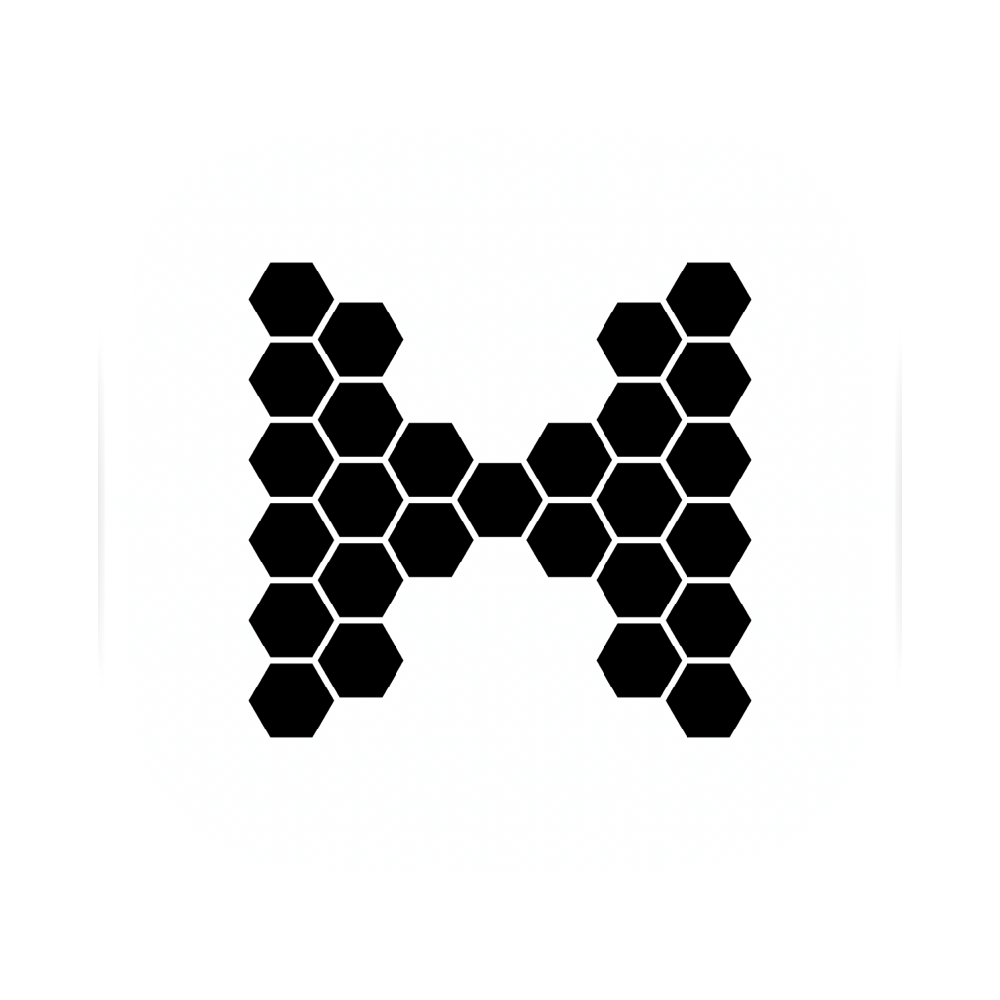
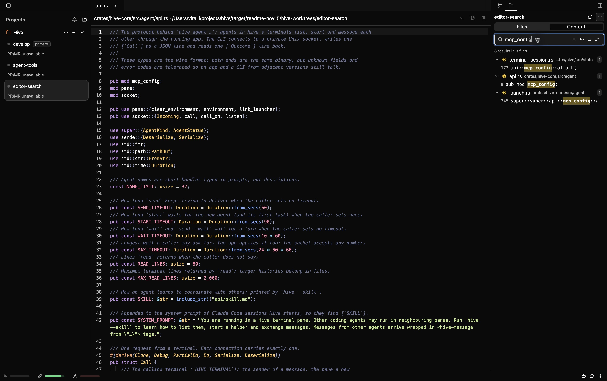
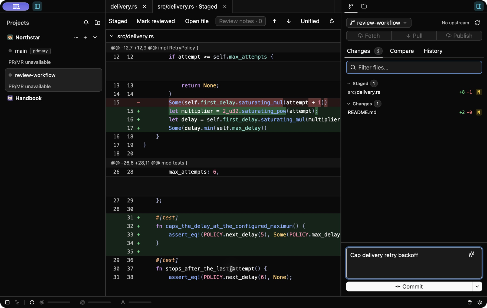
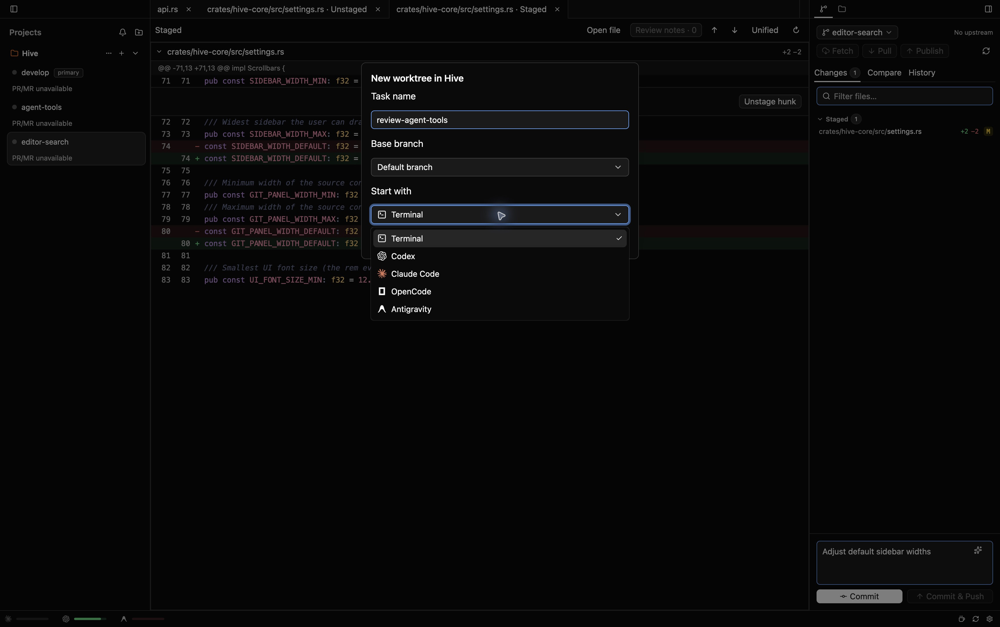

<p align="center">
  <picture>
    <source media="(prefers-color-scheme: dark)" srcset="crates/hive/assets/icons/hive-dark.png">
    
  </picture>
</p>

# Hive

**A native desktop workspace for AI coding agents.**

Run Claude Code, Codex, OpenCode, and other CLI agents side by side in isolated
Git worktrees. Give each task its own terminals, search and edit the code, review
diffs, resolve conflicts, and commit from one workspace. Agents can start helpers
and exchange messages through Hive’s MCP tools or CLI.

Built in Rust with GPUI, Hive runs natively on Apple Silicon Macs and also works
with Linux projects over SSH.



*Search across the project while editing, with isolated worktrees one click away.*

> **Hive 1.0 · macOS / Apple Silicon**
>
> Intel Macs are unsupported.
> Linux and Windows are planned.

## Download

[](https://github.com/one-reply/hive/releases/latest)

**Apple Silicon only.** The button opens GitHub Releases, where you can download
the latest stable release and its SHA-256 checksum.
Published builds have a Developer ID signature and Apple notarization.
See the [latest release notes](https://github.com/one-reply/hive/releases/latest)
for changes, verification results, and known limits.

Packaged builds from **0.1.1** include signed in-app updates. Open **Settings → Updates**
or **Hive → Check for Updates…** to check manually. Hive also checks daily and asks
before installing and restarting. Finish active agent sessions before restarting.
After updating, a compact notification links to the installed version’s release notes.
Older builds need one manual installation of a version that includes the updater.

## What you can do today

| Workflow | What Hive provides |
| --- | --- |
| **Organize your work** | Add local or SSH Linux projects, create and remove Git worktrees, reorder projects, and customize their names, colors, and icons. |
| **Start a task** | Create a worktree from a chosen base branch and launch a terminal, Claude Code, Codex, OpenCode, or Antigravity with **Create & Start**. |
| **Run agents in terminals** | Use terminal tabs and split panes, with text selection, scrollback, and clipboard image paste. See running agents on their worktree cards. |
| **Let agents work together** | Codex and Claude Code receive pane-specific MCP tools to list, start, message, read, wait for, and interrupt sibling agents. The `hive agent` CLI also supports coordination. |
| **Edit files** | Find files with **⌘P** or search local file contents with **⌘⇧F**. Use syntax highlighting, completion, inline Git blame, image previews, explicit saves, and recovery drafts. |
| **Manage files** | Create, rename, move, and delete files or folders; drag files between folders and see Git change badges in the tree. |
| **Navigate your workspace** | Jump to a project, worktree, or agent with **⌘K**. Use **Needs attention** to see the status, task, agent, project, and branch of sessions that need you. |
| **Pick up where you left off** | Restore selected worktrees, pinned files, terminal and diff tabs, split sizes, focus, and shell directories. Agent panes continue their Claude Code, Codex, OpenCode, or Antigravity conversation. |
| **Review and commit** | Inspect unified or split diffs, stage files or hunks, compare branches, browse history, and commit, fetch, pull, or push. |
| **Resolve conflicts** | Choose Current, Incoming, or both for each conflict block, review the result, then mark it resolved. Continue or abort the Git operation from the panel. |
| **Resume a conversation** | Open local Claude and Codex conversation history with **⌘⇧H**, then resume a past session in a terminal. |
| **Keep long tasks running** | Keep your Mac awake while agents work; the display can still sleep. Toggle it from the status bar. |
| **Send feedback to agents** | Annotate diff lines and copy an editable review prompt. Turn a Git error into a draft in the appropriate agent terminal, ready for you to submit. |
| **Follow pull and merge requests** | See GitHub PR or GitLab MR and CI status on worktree cards, with links to the request and failing CI, using your existing CLI sign-in. GitLab.com and self-managed GitLab are supported. |
| **Generate commit messages** | Use Codex, Claude Code, OpenCode, Antigravity, or an API provider to draft a message from staged changes. |
| **Track usage** | View compact usage bars for Claude Code, Codex, Cursor Agent, and Antigravity. Hover for limits, reset times, or sign-in help; unavailable limits appear gray. |
| **Make it yours** | Choose from six built-in themes, with independent light and dark palettes and automatic system switching; customize UI and code fonts, Files density and icons, and keyboard shortcuts. |
| **Keep Hive updated** | Check your installed version and install signed updates from Settings → Updates. |

Hive recognizes **Claude Code, Codex, OpenCode, Antigravity, Gemini CLI, Cursor Agent,
Copilot CLI, Qwen Code, Amp, Aider, and Droid** running in its local terminals. Install and sign
in to the agents you want to use separately, then launch them as you would in any
terminal.

Claude Code launched by Hive receives session-scoped hooks for working, input,
approval, turn completion, and failure states. Agents that support the Program
Status Protocol (OSC 7501) can report their status directly, including in SSH panes.
Without hooks or status reports, local agents use **estimated Working / Idle** based
on terminal output. Handle approval prompts in the agent's own terminal.

Restored terminals reopen in their last directories. A pane that was running Claude
Code, Codex, OpenCode, or Antigravity starts that agent again and continues the same
conversation; other processes and scrollback are not restored. Shell directories are
sampled once per second, so quitting immediately after `cd` may restore the previous
directory.

## A closer look



*Review changes, stage individual hunks, and keep the worktree's Git context visible.*



*Create an isolated worktree and choose the terminal or agent that starts in it.*

Screenshots captured on November 15, 2026 show Hive **1.0.21**, built from the
release source, with a disposable copy of Hive’s public code and sample changes.
See the [capture record](docs/RELEASE_CHECKS.md#readme-refresh--november-15-2026).

## Build and run

You need:

- A Mac with **Apple Silicon** and a native ARM64 Rust toolchain.
- **rustup** and Cargo; `rust-toolchain.toml` pins the tested Rust toolchain.
- **Xcode Command Line Tools** (or full Xcode) for the macOS SDK and native compiler.
- **Git** on your `PATH`.

If you do not already have Xcode or its Command Line Tools, install them first:

```sh
xcode-select --install
```

Then clone and run:

```sh
git clone https://github.com/one-reply/hive.git
cd hive
cargo run --locked -p hive
```

For a release build, use `cargo run --locked --release -p hive`.

### Your first workspace

1. Press **⌘O** to add a local repository, or choose **Add Project → Through SSH** for a Linux host.
2. Use the project's **+** button, choose a task name, base branch, and agent, then
   select **Create & Start**. Choose **Terminal** to start a plain shell instead.
3. Use **⌘K** to switch between tasks and agents, or **⌘T** to open another terminal.
4. Open files with **⌘P**, edit and save with **⌘S**, then review changes in **Git**.
5. Stage the files or hunks you want and commit. Use diff annotations when you want
   to send a review prompt back to an agent.

Projects, terminals, and Git tools work without configuring an AI API key in Hive.
Install and sign in to your preferred agent separately. Usage indicators read
supported CLI sign-ins.

For pull/merge requests and CI, open **Settings → Git** and connect **GitHub** or
**GitLab**. Hive reuses an installed `gh`/`glab` and existing sign-ins. If the CLI is
missing, **Install & Connect** downloads a pinned official Apple Silicon build,
checks its SHA-256, and installs it privately for Hive; Homebrew and administrator
access are not required. Finish the provider's authorization in your browser.
GitHub shows a one-time code with **Copy code & Open browser**. Credentials remain
managed by the official CLI, and PR/MR cards refresh after a successful connection.

For self-managed GitLab, enter the server hostname. Browser login requires an
OAuth Application ID configured for that server; supply it in Git settings or reuse
your existing `glab` configuration. The setup link explains the required OAuth
application. Your selected server is remembered across restarts; Hive does not
store access tokens in `state.json`. Connecting an account does not grant access
to repositories that the account cannot already read.

These settings connect this Mac. For SSH projects, install and sign in on the
remote host with `gh auth login` or `glab auth login --hostname <host>`. Hive uses
the CLI's repository context, including configured SSH aliases and host settings;
it does not copy local credentials to SSH hosts. If several MRs match a branch,
the card reports ambiguity instead of selecting one silently. MR and CI links
require HTTPS.

### Attention and usage

The bell opens **Needs attention**. Each entry shows why the session needs you,
its task title, agent, project or worktree, and branch. SSH entries also identify
the host. Search by any of that context, then press **Enter** to open the session.

The bottom bar uses provider icons and usage bars. Hover to see every usage window
and its reset time. A gray icon and empty gray bar mean usage is unavailable;
the hover card explains the error or how to sign in.

### Files and editing

The right sidebar switches between **Git** and **Files**. **⌘P** focuses the file
search for filenames and paths. Use **⌘⇧F** or the **Content** tab to search saved
file contents in a local project, with case, whole-word, and regular-expression
options. Results are grouped by file and open at the matching line. Content search
respects Git ignore rules and is not yet available over SSH.

Click a file to preview it, or double-click to keep it open. Raster images and SVGs
open in an image preview. File actions are available from the tree’s context menu,
including **Delete Permanently** with confirmation; local files can also be pasted
or dropped from Finder.

The editor supports local and remote UTF-8 files up to **1 MiB**, syntax highlighting,
find/replace, explicit saves, and recovery of unsaved drafts after a restart.
External edits are reloaded for clean files; unsaved files show a conflict instead
of silently overwriting either version. **⌘-click** follows JavaScript/TypeScript
imports to their definitions; **⌘⇧-click** opens them in an adjacent tab.

Inline Git blame shows the author and age of the current line, with commit details
and a link to history.

Code completion suggests names from the open file and JS/TS imports. Press
**⌃Space** to show suggestions, **Tab** or **Enter** to accept, or **Escape** to dismiss.
Disable it in **Settings → Files → Code completion**. Type-aware suggestions and
automatic imports require a language server and are not included.

### Agents working together

When launched by Hive, **Codex and Claude Code** receive MCP tools bound to their
own terminal pane. They can discover sibling agents, start a helper, send a
message, read terminal output, wait for a result, or interrupt a turn. Hive keeps
existing MCP servers and does not change global agent configuration or permissions.

**OpenCode and Antigravity** use the CLI fallback; automatic MCP setup is not
available for them. Agents in local terminals can use the `hive` command, which
Hive adds to each terminal’s `PATH`:

```sh
hive agent list
hive agent start reviewer --kind codex --prompt "Review the current diff"
hive agent send reviewer "Also check the tests" --wait
hive agent read reviewer --lines 40
```

`start` opens the agent in a pane beside the caller, or in a new tab with `--tab`,
under a unique name. A message reaches the recipient's prompt wrapped in
`<hive-message from="…">` together with the command to reply, so agents answer each
other without you copying text between panes. `hive --skill` prints the full
instructions for an agent; Claude Code started by Hive is pointed at them automatically.

A message never answers a dialog for you. An agent waiting for approval refuses
messages, and Enter is pressed only after the pasted text reaches the agent's prompt.
Claude Code started by Hive receives messages at once; other agents receive them
when their output pauses. SSH terminals cannot be reached yet, and Hive does not
change any agent's permissions.

### Linux projects over SSH

Choose **Add Project → Through SSH**, enter an SSH alias such as `home` or
`user@host`, then browse to a project folder. Hive uses OpenSSH with your existing
SSH config, keys, and agent. Connect once in a normal terminal first to accept the
host key and unlock your key if needed. Password entry inside Hive is not supported.

The host needs Linux on x86_64 or arm64, Git, and `sha256sum`. Hive installs its
versioned file helper in `~/.hive/bin` without sudo, Rust, a daemon, or an open port.
Files, filename search, editing, image previews, Git, worktrees, and terminal
splits operate on that host. Install and sign in to agent CLIs on the Linux machine separately;
Hive does not copy your Mac's credentials or agent hooks there.

Remote drafts stay on your Mac. Failed scans retain the last workspace, and an
interrupted save requires checking the remote file before another write. SSH
terminals have no tmux persistence or automatic agent restart: use **New SSH
Session** after disconnecting. Reported agent status is supported through OSC 7501; remote process-based
activity detection and conversation Resume are not available. Uploading local files or clipboard images and port
forwarding are deferred. Creating or removing worktrees currently requires UTF-8
paths; remote file operations also preserve non-UTF-8 Unix names.

### AI commit messages

Open **Settings → Workspace → Git** to choose a generator and customize its prompt.
CLI generation supports **Codex**, **Claude Code**, **OpenCode**, and **Antigravity**.
API generation supports **OpenAI, Anthropic, OpenRouter, and Google AI**; add the corresponding key in
**Settings → Workspace → AI**, then select a model in Git settings.

Stage your changes and click the sparkle button in the commit message field.
Review the generated message before committing. The default prompt includes the
branch name, staged filenames, and staged patch and sends them to your selected
CLI or API provider.

### Build a macOS app bundle

Packaging additionally requires **Xcode 26 or newer** for the app icon compiler,
**Python 3**, and **cargo-about** for third-party notices. Install the pinned release
tools into a local build directory:

```sh
python3 scripts/install-release-tools.py target/release-tools
python3 scripts/install-sparkle.py target/sparkle
```

Prepare both Linux helper binaries as described in
[Releasing](docs/RELEASING.md#linux-helpers), then build the bundle:

```sh
PATH="$PWD/target/release-tools:$PATH" bash scripts/bundle-macos.sh release
open target/release/bundle/Hive.app
```

This is the default output path; a custom Cargo target directory changes it.
By default, the script creates an ARM64-only, locally ad-hoc-signed preview, plus a
ZIP and SHA-256 file in release mode. Developer ID signing and Apple notarization
require the credentials described in [Releasing](docs/RELEASING.md#developer-id-and-notarization).

## Keyboard shortcuts

| Action | Default |
| --- | --- |
| Add project | ⌘O |
| Switch project, worktree, or agent | ⌘K |
| Find a file | ⌘P |
| Search local file contents | ⌘⇧F |
| Open conversation history | ⌘⇧H |
| Save file | ⌘S |
| Show code suggestions | ⌃Space |
| New terminal | ⌘T |
| Split terminal right | ⌘D |
| Split terminal down | ⌘⇧D |
| Focus the terminal pane on that side | ⌘← ⌘→ ⌘↑ ⌘↓ |
| Close focused terminal pane, editor, or diff | ⌘W |
| Toggle project sidebar | ⌘⇧\ |
| Toggle right sidebar (Git / Files) | ⌘\ |
| Show Git | ⌘⇧G |
| Show Files | ⌘⇧E |
| Commit staged changes, while focused in the Git panel | ⌘Enter |
| Open settings | ⌘, |

Shortcuts can be changed in **Settings → Application → Shortcuts**.

## Data and credentials

- Project references, workspace layouts, shell directories, and settings are stored in `~/.hive/state.json`.
- Unsaved editor drafts are stored under `~/.hive/editor-recovery/`; they can contain
  source code that has not been saved to the project yet.
- Worktrees created by Hive live beside the repository in `<repo>-worktrees/`.
- API keys entered in Hive are stored in **macOS Keychain**, separately from settings.
- Usage indicators read existing CLI credentials and contact the provider's usage
  endpoint. They refresh every five minutes or on demand. These integrations rely
  on undocumented endpoints and may stop working when providers change them.
- Claude hooks are scoped to sessions launched by Hive and do not modify global
  Claude settings. PR/MR and CI status uses read-only `gh`/`glab` queries.
- Logs are written to `~/.hive/logs/hive.log`. For troubleshooting, run
  `RUST_LOG=hive_core=debug cargo run --locked -p hive`. Usage diagnostics include
  HTTP status and response size, not response bodies or credentials. Other logs can
  include local paths and Git errors; review and redact them before sharing.

## What's next

The immediate focus is a dependable daily workflow with several terminal agents:
real-agent and notification testing, reliable restoration, and release verification.
Next steps include persistent remote sessions and remote agent activity tracking,
then Linux and Windows desktop support. These are not available in the current
build. A separate structured agent chat UI is deferred.

## Contributing

Bug reports, reproducible examples, and focused improvements are welcome. For a
larger change, open an issue first to discuss the approach. Include your macOS
version, Hive commit, reproduction steps, and relevant redacted logs in bug reports.

The workspace has two crates:

| Crate | Responsibility |
| --- | --- |
| [`hive-core`](crates/hive-core) | Domain logic, Git and CLI adapters, HTTP clients, persistence, and the terminal model. No GPUI dependency. |
| [`hive`](crates/hive) | The GPUI app, state entities, views, and terminal rendering. |

Read [CONTRIBUTING.md](CONTRIBUTING.md) for engineering conventions and
[SECURITY.md](SECURITY.md) for private vulnerability reporting.

Before submitting a change:

```sh
cargo fmt --all
cargo clippy --locked --workspace --all-targets -- -D warnings
cargo test --locked --workspace
cargo tree --locked -p hive-core | grep gpui
```

The last command must print nothing (`grep` exits with status 1 when there are no
matches). Verify UI changes in the running app and update the relevant documentation
when behavior or architecture changes.

## License

Hive is licensed under [Apache-2.0](LICENSE). Third-party dependencies and artwork
retain their own licenses; see [third-party notices](THIRD_PARTY_NOTICES.md).
