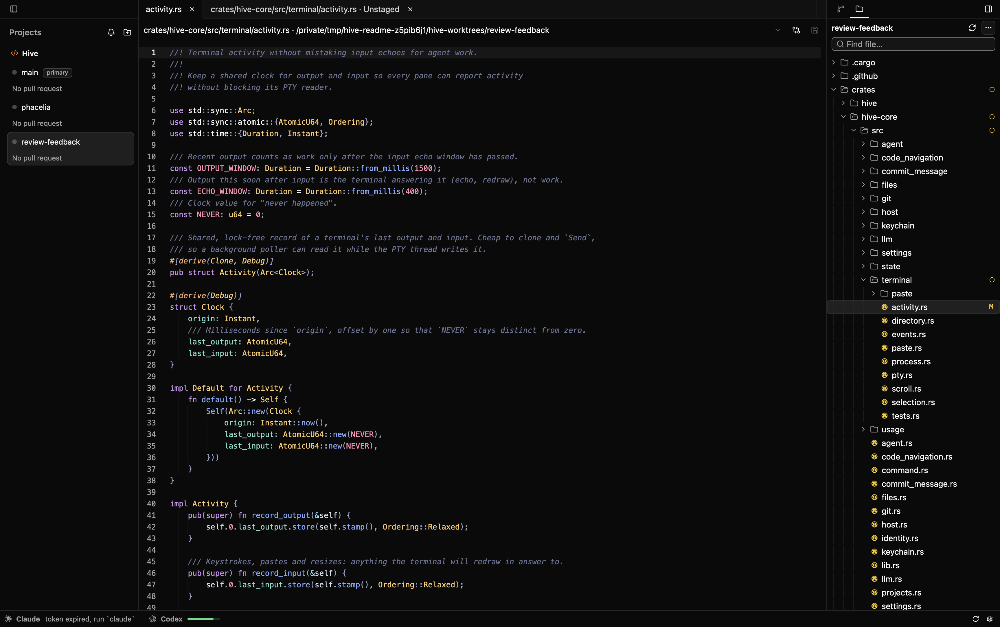
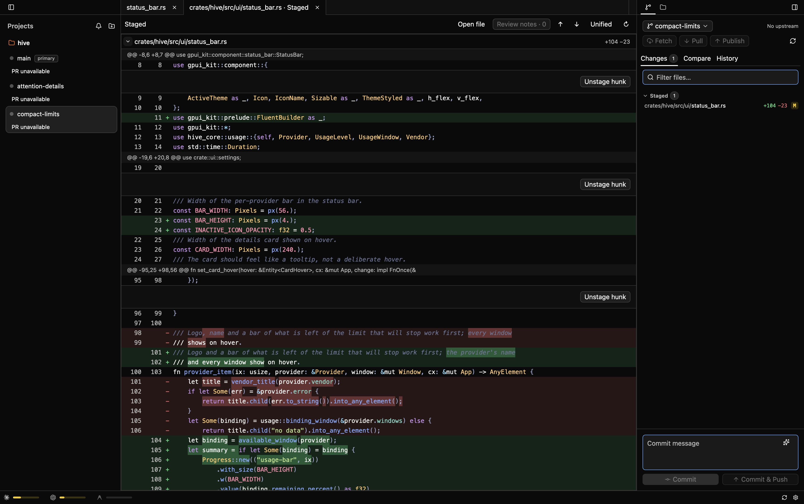
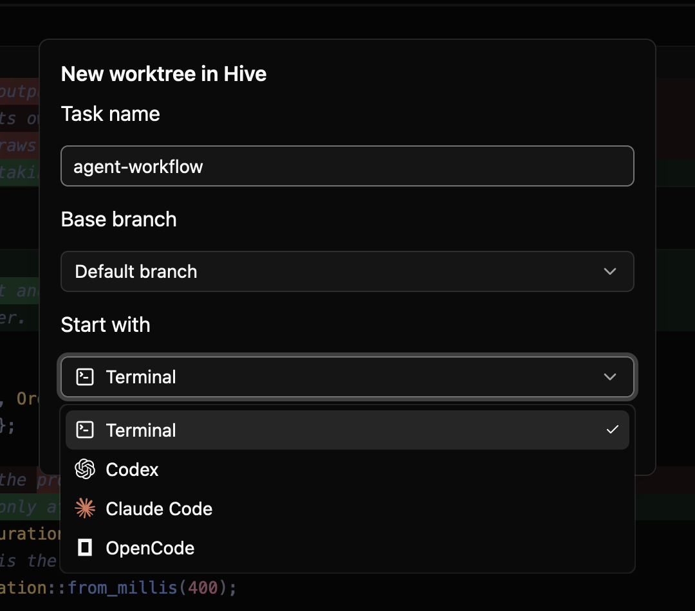

<p align="center">
  <picture>
    <source media="(prefers-color-scheme: dark)" srcset="crates/hive/assets/icons/hive-dark.png">
    
  </picture>
</p>

# Hive

**A native desktop workspace for AI coding agents.**

Run agents in separate Git worktrees, edit their changes, and review and commit
without leaving your workspace. Hive brings projects, terminals, a native code
editor, and Git tools together in a Rust app, rendered with GPUI through `gpui-kit`.



*Hive editing its own Rust source, with worktrees on the left and Files on the right.*

> **Early development · macOS / Apple Silicon**
>
> Hive is early software; features and interfaces are still evolving.
> Intel Macs are unsupported.
> Linux and Windows are planned.

## Download

There are **no published binary releases yet** as of November 6, 2026. Use the
[source build](#build-and-run) below. Packaged downloads will appear on
[GitHub Releases](https://github.com/one-reply/hive/releases) after release
verification. See the [verification record](docs/RELEASE_CHECKS.md) for completed
and pending checks.

Packaged builds from **0.1.1** include signed in-app updates. Open **Settings → Updates**
or **Hive → Check for Updates…** to check manually. Hive also checks daily and asks
before installing and restarting. Finish active agent sessions before restarting.
Older builds need one manual installation of a version that includes the updater.

## What you can do today

| Workflow | What Hive provides |
| --- | --- |
| **Organize your work** | Add local projects, create and remove Git worktrees, reorder projects, and customize their names, colors, and icons. |
| **Start a task** | Create a worktree from a chosen base branch and launch a terminal, Claude Code, Codex, or OpenCode with **Create & Start**. |
| **Run agents in terminals** | Use terminal tabs and split panes, with text selection, scrollback, and clipboard image paste. See running agents on their worktree cards. |
| **Edit files** | Browse and search with **Files / ⌘P**, use syntax highlighting and preview or pinned tabs, save with **⌘S**, and handle external changes and recovery drafts. |
| **Manage files** | Create, rename, move, and delete files or folders; drag files between folders and see Git change badges in the tree. |
| **Navigate your workspace** | Jump to a project, worktree, or agent with **⌘K**. Use **Needs attention** to find Claude sessions waiting for input or approval. |
| **Pick up where you left off** | Restore selected worktrees, pinned files, terminal and diff tabs, split sizes, focus, and shell directories. Explicitly resume saved Claude Code and OpenCode conversations. |
| **Review and commit** | Inspect unified or split diffs, stage files or hunks, compare branches, browse history, and commit, fetch, pull, or push. |
| **Send feedback to agents** | Annotate diff lines and copy an editable review prompt. Turn a Git error into a draft in the appropriate agent terminal, ready for you to submit. |
| **Follow pull requests** | See PR and CI status on worktree cards, with links to the PR and failing checks, using your existing GitHub CLI sign-in. |
| **Generate commit messages** | Use Codex, Claude Code, OpenCode, or an API provider to draft a message from staged changes. |
| **Track usage** | View Claude Code, Codex, Cursor Agent, and Antigravity usage limits and reset times using existing CLI sign-ins. |
| **Make it yours** | Choose system, light, or dark appearance; customize UI and code fonts, Files density and icons, and keyboard shortcuts. |
| **Keep Hive updated** | Check your installed version and install signed updates from Settings → Updates. |

Hive recognizes **Claude Code, Codex, OpenCode, Gemini CLI, Cursor Agent, Copilot CLI,
Qwen Code, Amp, Aider, and Droid** running in its local terminals. Install and sign
in to the agents you want to use separately, then launch them as you would in any
terminal.

Claude Code launched by Hive receives session-scoped hooks for working, input,
approval, turn completion, and failure states. Other agents, and Claude launched manually
in a shell, use **estimated Working / Idle** based on terminal output. Handle
approval prompts in the agent's own terminal.

Restored terminals start fresh shells; running processes and scrollback are not
restored. **Resume** starts a new agent tab when a saved Claude Code or OpenCode
session ID is available. Codex conversation IDs are not captured yet. Shell
directories are sampled once per second, so quitting immediately after `cd` may
restore the previous directory.

## A closer look



*Review changes, stage individual hunks, and keep the worktree's Git context visible.*



*Create an isolated worktree and choose the terminal or agent that starts in it.*

Screenshots use a development build and a disposable copy of Hive's public source.

## Build and run

You need:

- A Mac with **Apple Silicon** and a native ARM64 Rust toolchain.
- **rustup** and Cargo; `rust-toolchain.toml` pins the tested Rust toolchain.
- **Xcode Command Line Tools** (or full Xcode) for the macOS SDK and native compiler.
- **Git** on your `PATH`.

If you do not already have Xcode or its Command Line Tools, install them first:

```sh
xcode-select --install
```

Then clone and run:

```sh
git clone https://github.com/one-reply/hive.git
cd hive
cargo run --locked -p hive
```

For a release build, use `cargo run --locked --release -p hive`.

### Your first workspace

1. Press **⌘O** to add a local repository.
2. Use the project's **+** button, choose a task name, base branch, and agent, then
   select **Create & Start**. Choose **Terminal** to start a plain shell instead.
3. Use **⌘K** to switch between tasks and agents, or **⌘T** to open another terminal.
4. Open files with **⌘P**, edit and save with **⌘S**, then review changes in **Git**.
5. Stage the files or hunks you want and commit. Use diff annotations when you want
   to send a review prompt back to an agent.

Projects, terminals, and Git tools work without configuring an AI API key in Hive.
Install and sign in to your preferred agent separately. Usage indicators read
supported CLI sign-ins; PR/CI cards additionally require **`gh`** signed in to GitHub.

### Files and editing

The right sidebar switches between **Git** and **Files**. **⌘P** focuses the file
search; it searches filenames and paths, not file contents. Click a file to preview
it, or double-click to keep it open. File actions are available from the tree's
context menu, including **Delete Permanently** with confirmation.

The editor supports local UTF-8 files up to **1 MiB**, syntax highlighting,
find/replace, explicit saves, and recovery of unsaved drafts after a restart.
External edits are reloaded for clean files; unsaved files show a conflict instead
of silently overwriting either version. **⌘-click** follows JavaScript/TypeScript
imports to their definitions; **⌘⇧-click** opens them in an adjacent tab. A full
language server and autocomplete are not included.

### AI commit messages

Open **Settings → Workspace → Git** to choose a generator and customize its prompt.
CLI generation supports **Codex**, **Claude Code**, and **OpenCode**. API generation
supports **OpenAI, Anthropic, OpenRouter, and Google AI**; add the corresponding key in
**Settings → Workspace → AI**, then select a model in Git settings.

Stage your changes and click the sparkle button in the commit message field.
Review the generated message before committing. The default prompt includes the
branch name, staged filenames, and staged patch and sends them to your selected
CLI or API provider.

### Build a macOS app bundle

Packaging additionally requires **Xcode 26 or newer** for the app icon compiler,
**Python 3**, and **cargo-about** for third-party notices. Install the pinned release
tools into a local build directory:

```sh
python3 scripts/install-release-tools.py target/release-tools
python3 scripts/install-sparkle.py target/sparkle
PATH="$PWD/target/release-tools:$PATH" bash scripts/bundle-macos.sh release
open target/release/bundle/Hive.app
```

This is the default output path; a custom Cargo target directory changes it.
By default, the script creates an ARM64-only, locally ad-hoc-signed preview, plus a
ZIP and SHA-256 file in release mode. Developer ID signing and Apple notarization
require the credentials described in [Releasing](docs/RELEASING.md#developer-id-and-notarization).

## Keyboard shortcuts

| Action | Default |
| --- | --- |
| Add project | ⌘O |
| Switch project, worktree, or agent | ⌘K |
| Find a file | ⌘P |
| Save file | ⌘S |
| New terminal | ⌘T |
| Split terminal right | ⌘D |
| Split terminal down | ⌘⇧D |
| Close focused terminal pane, editor, or diff | ⌘W |
| Toggle project sidebar | ⌘⇧\ |
| Toggle right sidebar (Git / Files) | ⌘\ |
| Commit staged changes, while focused in the Git panel | ⌘Enter |
| Open settings | ⌘, |

Shortcuts can be changed in **Settings → Application → Shortcuts**.

## Data and credentials

- Project references, workspace layouts, shell directories, and settings are stored in `~/.hive/state.json`.
- Unsaved editor drafts are stored under `~/.hive/editor-recovery/`; they can contain
  source code that has not been saved to the project yet.
- Worktrees created by Hive live beside the repository in `<repo>-worktrees/`.
- API keys entered in Hive are stored in **macOS Keychain**, separately from settings.
- Usage indicators read existing CLI credentials and contact the provider's usage
  endpoint. They refresh every five minutes or on demand. These integrations rely
  on undocumented endpoints and may stop working when providers change them.
- Claude hooks are scoped to sessions launched by Hive and do not modify global
  Claude settings. PR/CI status uses read-only `gh` queries.
- Logs are written to `~/.hive/logs/hive.log`. For troubleshooting, run
  `RUST_LOG=hive_core=debug cargo run --locked -p hive`. Usage diagnostics include
  HTTP status and response size, not response bodies or credentials. Other logs can
  include local paths and Git errors; review and redact them before sharing.

## What's next

The immediate focus is a dependable daily workflow with several terminal agents:
real-agent and notification testing, reliable restoration, and release verification.
Next steps include automatic Codex conversation resume, SSH configuration and
remote agent launch, then Linux and Windows support. These are not available in
the current build. A separate structured agent chat UI is deferred.

## Contributing

Bug reports, reproducible examples, and focused improvements are welcome. For a
larger change, open an issue first to discuss the approach. Include your macOS
version, Hive commit, reproduction steps, and relevant redacted logs in bug reports.

The workspace has two crates:

| Crate | Responsibility |
| --- | --- |
| [`hive-core`](crates/hive-core) | Domain logic, Git and CLI adapters, HTTP clients, persistence, and the terminal model. No GPUI dependency. |
| [`hive`](crates/hive) | The GPUI app, state entities, views, and terminal rendering. |

Read [CONTRIBUTING.md](CONTRIBUTING.md) for engineering conventions and
[SECURITY.md](SECURITY.md) for private vulnerability reporting.

Before submitting a change:

```sh
cargo fmt --all
cargo clippy --locked --workspace --all-targets -- -D warnings
cargo test --locked --workspace
cargo tree --locked -p hive-core | grep gpui
```

The last command must print nothing (`grep` exits with status 1 when there are no
matches). Verify UI changes in the running app and update the relevant documentation
when behavior or architecture changes.

## License

Hive is licensed under [Apache-2.0](LICENSE). Third-party dependencies and artwork
retain their own licenses; see [third-party notices](THIRD_PARTY_NOTICES.md).
